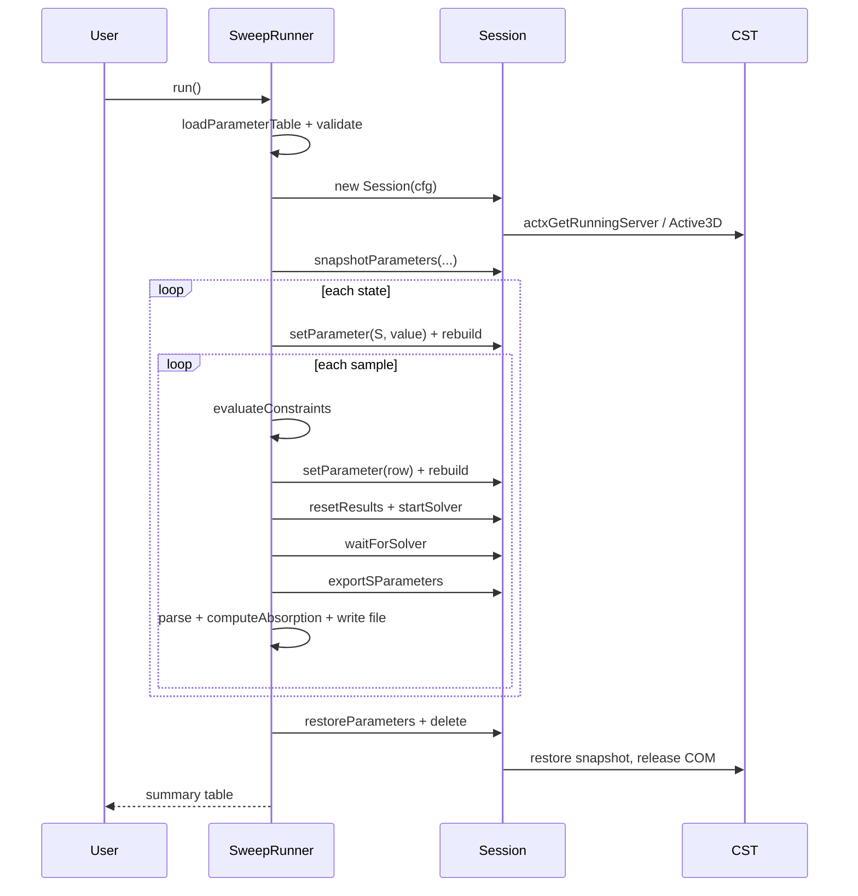

# Architecture

The package is split into a small orchestration layer and side-effect-free
helpers, so most logic can be tested without CST.

## Modules

| Module | Responsibility |
| --- | --- |
| `cstsweep.Config` | Typed configuration with validation and defaults. |
| `cstsweep.Session` | CST COM connection, parameter snapshot, rebuild, solver control, ASCII export. |
| `cstsweep.SweepRunner` | Orchestration, per-sample error policy, result collection. |
| `cstsweep.Logger` | Timestamped console and file logging. |
| `cstsweep.loadParameterTable` | CSV loading and numeric validation. |
| `cstsweep.evaluateConstraints` | Geometry rules. |
| `cstsweep.readSParameters` | ASCII export parser (dB or linear). |
| `cstsweep.computeAbsorption` | `A = 1 - |S11|^2` and peak metrics. |
| `cstsweep.readAbsorptionFile` / `writeAbsorptionFile` | Persisted curves. |

`run_sweep.m` is a thin entry point: it adds `src/` to the path, loads a
configuration function, and hands control to `SweepRunner`.

## Execution sequence

## COM lifecycle

`Session` is a handle class with a destructor. The runner registers
`onCleanup(@() obj.closeSession())`, so the parameter snapshot is restored and
the COM handles are released on normal return, on error, and on `Ctrl+C`.

The snapshot includes the state parameter as well as every geometry parameter.
Restoration is best-effort: a parameter that cannot be written is logged as a
warning, and the remaining parameters are still restored.

`cstsweep.Session.connect` uses `actxGetRunningServer`. When
`StartCstIfNeeded` is true it falls back to `actxserver` and opens
`ProjectPath`; otherwise it raises an actionable error.

## Solver completion detection

CST versions expose different status methods, so `waitForSolver` probes, in
order:

1. `GetSolverStatus`
2. `IsRunning`
3. `Status`

The reply is mapped to running / not running by `interpretStatus`. If none of
the probes responds, the runner falls back to polling whether the configured
result tree item exists, and logs a warning once. A successful non-empty export
is only attempted after completion is detected, so stale results from a
previous run cannot be mistaken for new ones (`ResetResultsBeforeRun` clears
the tree first).

When the timeout expires, `stopSolver` asks CST to stop, the sample is recorded
as `solver timeout`, and the sweep continues with the next row.

## Error policy

Each sample is wrapped in `try`/`catch`. Failures are classified by phase:

| Phase | Recorded reason |
| --- | --- |
| Setup (parameter write, rebuild, solver start) | `setup failed: <message>` |
| Solver wait | `solver timeout` |
| Export/parse | `export failed: <message>` |
| Constraint | rule reason, for example `R2<=R3` |

With `ContinueOnError = true` (default) the sweep moves on; with `false` the
error is rethrown after cleanup. Errors outside a sample (configuration, CSV,
connection) abort the run immediately.

## Idempotency and resume

Output files are named deterministically from the state prefix and the sample
index. With `SkipExistingResults`, an existing file is parsed and folded into
the summary instead of being solved again. The temporary ASCII export is
deleted after each sample unless `KeepTemporaryFiles` is true.

## Extension points

- **Transmission.** Replace `computeAbsorption` with
  `A = 1 - |S11|^2 - |S21|^2` and export both ports.
- **Other result types.** `Session.exportSParameters` only depends on a tree
  path; add a sibling method for far fields or surface currents.
- **Parallel sweeps.** One Session maps to one CST instance. A future runner
  could shard rows across several instances, each with its own `OutputDir`.
- **Built-in CST sweeps.** CST's own parameter sweep is faster for large
  batches; this package favours explicit per-sample records and failure
  isolation.
